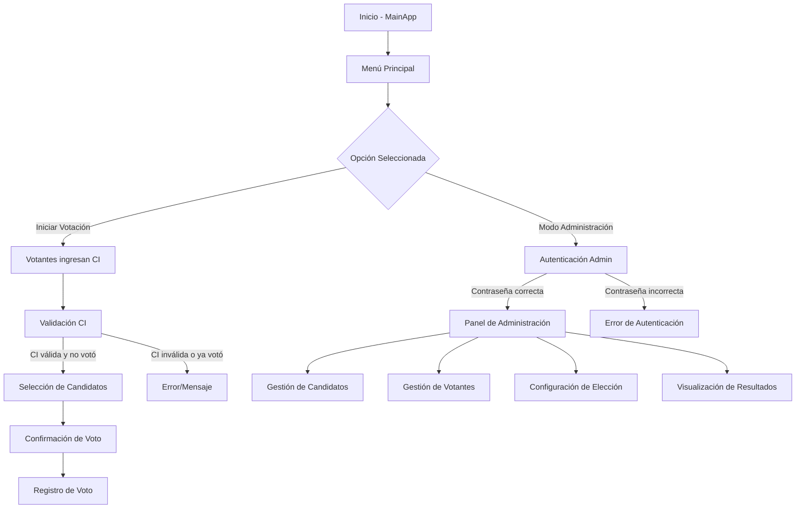

# 🏛️ Sistema de Votación Escolar

<div align="center">

[](https://www.python.org/)
[](https://docs.python.org/3/library/tkinter.html)
[](https://www.sqlite.org/)
[](https://matplotlib.org/)

</div>

---

<div align="center">
  <h3>🗳️ Gestión completa de elecciones escolares con interfaz intuitiva y segura</h3>
  <p>Aplicación de escritorio para gestionar elecciones estudiantiles, permitiendo a los estudiantes votar por sus representantes para los cargos de Directora, Vice Directora y Coordinadora.</p>
</div>

---

## 📋 Tabla de Contenidos

- [✨ Características Principales](#-características-principales)
- [🛠️ Tecnologías Utilizadas](#️-tecnologías-utilizadas)
- [⚙️ Instalación y Uso](#️-instalación-y-uso)
- [📦 Ejecutable para Windows](#-ejecutable-para-windows)
- [🏗️ Arquitectura del Proyecto](#️-arquitectura-del-proyecto)
- [💻 Módulos del Sistema](#-módulos-del-sistema)
- [🔄 Flujo de la Aplicación](#-flujo-de-la-aplicación)
- [🎯 Funcionalidades Principales](#-funcionalidades-principales)
- [🔐 Seguridad y Autenticación](#-seguridad-y-autenticación)
- [📈 Resultados y Estadísticas](#-resultados-y-estadísticas)
- [🔧 Desarrollo y Contribución](#-desarrollo-y-contribución)
- [📄 Licencia](#-licencia)

---

## ✨ Características Principales

<div align="center">

| Característica | Descripción |
|:---:|:---:|
| 🎨 **Interfaz Intuitiva** | Diseño limpio y amigable para usuarios escolares |
| 🔐 **Autenticación Segura** | Validación por CI con prevención de votos duplicados |
| 📊 **Resultados en Tiempo Real** | Visualización instantánea de votos y gráficos |
| 📈 **Gestión Completa** | Administración de candidatos, votantes y elecciones |
| 📱 **Diseño Adaptativo** | Interfaz que se adapta a diferentes tamaños de pantalla |
| 🗂️ **Importación Masiva** | Carga de votantes desde archivos CSV |

</div>

### 🎯 Beneficios del Sistema

- **Simplicidad**: Interfaz clara y sencilla de usar
- **Seguridad**: Control de identidad y prevención de fraudes
- **Eficiencia**: Proceso de votación rápido y confiable
- **Transparencia**: Resultados visibles y verificables
- **Mantenibilidad**: Código modular y bien documentado

---

## 🛠️ Tecnologías Utilizadas

<div align="center">

| Tecnología | Versión Mínima | Descripción |
|:---:|:---:|
| [🐍 Python](https://www.python.org/) | 3.7+ | Lenguaje principal del sistema |
| [🖼️ Tkinter](https://docs.python.org/3/library/tkinter.html) | Built-in | Interfaz gráfica de usuario |
| [💾 SQLite](https://www.sqlite.org/) | Built-in | Base de datos ligera y eficiente |
| [📊 Matplotlib](https://matplotlib.org/) | 3.0+ | Visualización de gráficos |
| [🖼️ Pillow](https://python-pillow.org/) | 8.0+ | Procesamiento de imágenes |

</div>

---

## ⚙️ Instalación y Uso

### 📋 Requisitos del Sistema

- **Sistema Operativo**: Windows 7+, macOS 10.12+, Linux (Ubuntu 18.04+)
- **Python**: Versión 3.7 o superior
- **Memoria RAM**: 512 MB mínimo
- **Espacio en disco**: 100 MB disponible

### 📦 Instalación

1. **Clonar o descargar el proyecto**
   ```bash
   git clone https://github.com/tu-usuario/padron-electoral-escolar.git
   cd padron-electoral-escolar
   ```

2. **Crear un entorno virtual (recomendado)**
   ```bash
   # En Windows
   python -m venv venv
   .\venv\Scripts\activate
   
   # En macOS/Linux
   python3 -m venv venv
   source venv/bin/activate
   ```

3. **Instalar dependencias**
   ```bash
   pip install -r requirements.txt
   ```

### 🚀 Uso

Para iniciar la aplicación, ejecuta el siguiente comando en la raíz del proyecto:

```bash
# En Windows
python main.py

# En macOS/Linux
python3 main.py
```

## 📦 Ejecutable para Windows

### 🚀 Opción 1: Ejecutable Directo (Recomendado para usuarios finales)

Descarga la versión compilada del sistema para Windows sin necesidad de instalar Python:

1. **Descargar el ejecutable**:
   - Ve a la sección de [Releases](https://github.com/rodrigoangeloni/padron-electoral-escolar/releases) del repositorio
   - Descarga el archivo `SistemaVotacionEscolar.exe` correspondiente a la versión más reciente
   - Ejecuta el archivo directamente en tu sistema Windows

2. **Características del ejecutable**:
   - Incluye todas las dependencias necesarias
   - No requiere instalación de Python ni bibliotecas adicionales
   - Totalmente portátil y listo para usar
   - Icono personalizado y metadatos del desarrollador

### 🔧 Opción 2: Instalación desde código fuente (Desarrolladores)

Sigue las instrucciones de instalación anteriores si deseas ejecutar desde el código fuente o contribuir al desarrollo.

---

## 🏗️ Arquitectura del Proyecto

```
padron-electoral-escolar/
├── 📁 assets/                    # Recursos multimedia
│   ├── 📁 config/               # Configuraciones
│   ├── 📁 db/                   # Base de datos
│   └── 📁 images/               # Imágenes y recursos visuales
├── 📁 utils/                    # Utilidades y módulos auxiliares
│   ├── 📄 auth.py               # Autenticación
│   ├── 📄 candidate_ui.py       # UI de candidatos
│   ├── 📄 voter_ui.py           # UI de votantes
│   └── 📄 results_ui.py         # UI de resultados
├── 📄 main.py                   # Controlador principal
├── 📄 config.py                 # Configuración central
├── 📄 database.py               # Gestión de base de datos
├── 📄 admin_app.py              # Interfaz de administración
├── 📄 voting_app.py             # Interfaz de votación
├── 📄 run_app.py                # Script de ejecución
├── 📄 requirements.txt          # Dependencias
├── 📄 README.md                 # Documentación principal
└── 📄 CHANGELOG.md              # Registro de cambios
```

---

## 💻 Módulos del Sistema

### 📚 Descripción de Módulos

| Módulo | Función Principal | Responsabilidad |
|:---:|:---:|
| `main.py` | Controlador Principal | Gestión de vistas y flujo de la aplicación |
| `config.py` | Configuración Central | Constantes, rutas y parámetros del sistema |
| `database.py` | Gestión de Base de Datos | Operaciones CRUD y manejo de datos |
| `admin_app.py` | Interfaz de Administración | Gestión de candidatos, votantes y resultados |
| `voting_app.py` | Interfaz de Votación | Proceso de votación y autenticación |
| `utils/auth.py` | Autenticación | Validación de credenciales administrativas |
| `utils/candidate_ui.py` | UI de Candidatos | Funcionalidad específica de candidatos |
| `utils/voter_ui.py` | UI de Votantes | Funcionalidad específica de votantes |
| `utils/results_ui.py` | UI de Resultados | Visualización de resultados y gráficos |

---

## 🔄 Flujo de la Aplicación

<div align="center">



</div>

---

## 🎯 Funcionalidades Principales

### 👤 Gestión de Candidatos

- **Agregar/Editar/Eliminar**: Administración completa de perfiles de candidatos
- **Subida de Fotos**: Carga de imágenes personalizadas para cada candidato
- **Filtros Avanzados**: Búsqueda por cargo, grado y otros criterios
- **Vista Previa**: Visualización de imágenes antes de confirmar

### 👥 Gestión de Votantes

- **Registro Individual**: Agregar votantes manualmente
- **Importación Masiva**: Carga desde archivos CSV con formato específico
- **Validación CI**: Control de identidad y prevención de duplicados
- **Estado de Votación**: Seguimiento de quién ya votó y quién no

### 📊 Visualización de Resultados

- **Tablas Dinámicas**: Resultados actualizados en tiempo real
- **Gráficos Interactivos**: Visualización de tendencias y comparativas
- **Exportación**: Opción de exportar resultados en diferentes formatos
- **Resumen por Cargos**: Presentación organizada por posición electoral

### ⚙️ Configuración del Sistema

- **Control de Estado**: Activación y cierre de la votación
- **Cambio de Contraseña**: Seguridad de acceso administrativo
- **Personalización**: Configuración de cargos, grados y otros parámetros
- **Votos Múltiples Correctamente Registrados**: Sistema asegura que todos los votos (Directora, Vice Directora y Coordinadora) se registren correctamente para cada votante


---

## 🔐 Seguridad y Autenticación

### 🛡️ Medidas de Seguridad Implementadas

- **Hash de Contraseñas**: Almacenamiento seguro de credenciales administrativas
- **Validación de CI**: Control de identidad para prevenir votos duplicados
- **Sesiones Seguras**: Gestión de estado de votación para cada usuario
- **Auditoría de Acciones**: Registro de operaciones críticas

### 📝 Política de Seguridad

- Las contraseñas se almacenan con hash SHA-256
- Se previene el acceso concurrente de votantes
- Se mantiene un registro de cambios en la configuración
- Se implementa control de acceso basado en roles

---

## 📈 Resultados y Estadísticas

### 📊 Tipos de Resultados Disponibles

- **Resultados por Cargo**: Visualización detallada de votos por posición
- **Resultados por Grado**: Comparativas entre diferentes niveles educativos
- **Gráficos de Barras**: Representación visual de tendencias
- **Ganadores por Cargo**: Destacado de candidatos ganadores
- **Participación**: Porcentaje de participación electoral

---

## 🔧 Desarrollo y Contribución

### 🤝 Cómo Contribuir

1. **Fork** el repositorio
2. **Crea una rama** (`git checkout -b feature/nueva-funcionalidad`)
3. **Realiza tus cambios** y haz commit (`git commit -m 'Añadir nueva funcionalidad'`)
4. **Sube los cambios** (`git push origin feature/nueva-funcionalidad`)
5. **Abre un Pull Request**

### 🧪 Pruebas

- El sistema incluye pruebas de funcionalidad básicas
- Se recomienda probar cada módulo individualmente
- Verificar la compatibilidad con diferentes resoluciones de pantalla

### 📝 Estándares de Código

- **PEP 8**: Estándar de codificación para Python
- **Documentación**: Cada función debe estar documentada
- **Nomenclatura**: Nombres descriptivos para variables y funciones
- **Comentarios**: Explicación de lógica compleja

---

## 📄 Licencia

<div align="center">

```
Copyright (c) 2025 Rodrigo Angeloni

Permiso está garantizado para cualquier persona que obtenga una copia 
de este software y archivos de documentación asociados (el "Software"), 
para usar, copiar, modificar, fusionar, publicar, distribuir, sublicenciar, 
y/o vender copias del Software, sujeto a las siguientes condiciones:

- El aviso de copyright anterior y este aviso de permiso se incluirán 
  en todas las copias o partes sustanciales del Software.

- Queda prohibida la venta del Software o sus derivados sin el permiso 
  expreso por escrito del titular del copyright.

EL SOFTWARE SE PROPORCIONA "TAL CUAL", SIN GARANTÍA DE NINGÚN TIPO, 
EXPRESA O IMPLÍCITA, INCLUYENDO PERO NO LIMITADO A GARANTÍAS DE 
COMERCIALIZACIÓN, IDONEIDAD PARA UN PROPÓSITO PARTICULAR Y NO INFRACCIÓN. 
EN NINGÚN CASO LOS TITULARES DEL COPYRIGHT O TITULARES DE DERECHOS 
SERÁN RESPONSABLES DE NINGUNA RECLAMACIÓN, DAÑO U OTRA RESPONSABILIDAD, 
YA SEA EN UNA ACCIÓN DE CONTRATO, AGRAVIO O CUALQUIER OTRO MOTIVO, 
DERIVADA DEL USO DEL SOFTWARE O RELACIONADA CON EL SOFTWARE O SU USO 
O CUALQUIER OTRO TRATO EN EL SOFTWARE.
```

</div>

---

<div align="center">

### 🙏 Agradecimientos

Este proyecto fue desarrollado para facilitar procesos democráticos entornos escolares. Agradecemos a todos los contribuyentes y usuarios que hacen posible su mejora continua.

</div>