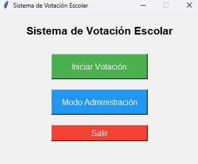
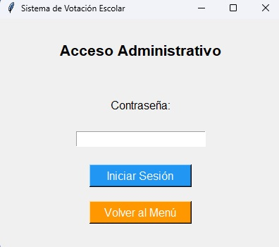
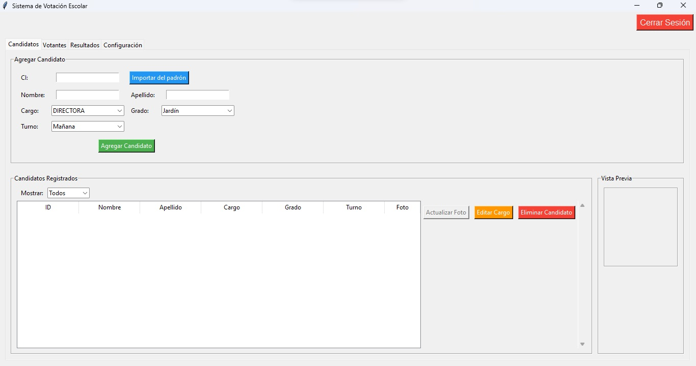
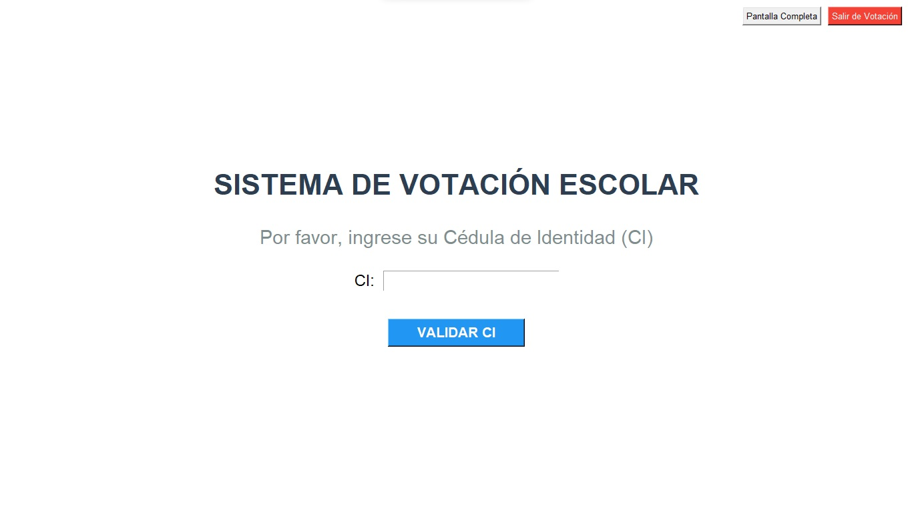

# Sistema de Votación Escolar

Aplicación de escritorio para gestionar elecciones estudiantiles: cargos dinámicos, candidatos, padrón de votantes, votación por CI y resultados con gráficos y PDF.

[](https://www.python.org/)
[](https://github.com/rodrigoangeloni/padron-electoral-escolar)
[](https://github.com/rodrigoangeloni/padron-electoral-escolar/releases)
[](tests/)

## Características

- **Cargos dinámicos**: crear y eliminar cargos desde Configuración, sin tocar código.
- **Candidatos**: alta, baja, edición de cargo y fotos (JPG/PNG hasta 5 MB, validadas).
- **Votantes**: registro individual o importación masiva desde CSV, validación de CI (7-8 dígitos) y prevención de voto duplicado. Sin CI: usar fecha de nacimiento DDMMYYYY (ej. `01092000` = 01/09/2000).
- **Votación guiada**: un paso por cargo, confirmación final y comprobante en pantalla.
- **Turnos**: el admin elige el **turno a votar** (Mañana/Tarde) al activar la votación: se vota Mañana, se cierra, se cambia a Tarde y se activa de nuevo. La papeleta muestra los candidatos del turno activo y rechaza votantes de otro turno; padrón, resultados y acta con filtros por turno.
- **Resultados**: tabla, ganadores por cargo (con empates), gráficos y acta en PDF con participación, porcentajes y firmas — por turno (Mañana/Tarde/Ambos).
- **Seguridad**: contraseña admin con PBKDF2 + salt, bloqueo tras intentos fallidos y control de estado (activa/cerrada).

## 📸 Capturas de pantalla

| Menú principal | Acceso administrativo |
|---|---|
|  |  |

| Panel de administración | Votación: ingreso de CI |
|---|---|
|  |  |

## Descarga rápida (usuarios finales)

1. Ve a [Releases](https://github.com/rodrigoangeloni/padron-electoral-escolar/releases) y descarga `SistemaVotacionEscolar.exe`.
2. Ejecuta el archivo. No requiere instalar Python ni nada más.
3. Los datos se guardan junto al ejecutable y persisten entre sesiones.

## Instalación desde código (desarrolladores)

Requisitos: Windows 7+ (también funciona en macOS/Linux desde código), Python 3.11, 512 MB RAM.

```bash
git clone https://github.com/rodrigoangeloni/padron-electoral-escolar.git
cd padron-electoral-escolar

python -m venv .venv
.\.venv\Scripts\activate        # macOS/Linux: source .venv/bin/activate
pip install -r requirements.txt
```

Para desarrollo y tests:

```bash
pip install -r requirements-dev.txt
```

## Uso

```bash
python main.py        # o: python run_app.py (crea el .venv si falta)
```

En Windows también podés doble clic en `1_iniciar.bat`: crea el `.venv` si falta y abre la app sin consola.

### Primer uso (administrador)

1. Entra a **Modo Administración**. La primera vez se genera una contraseña inicial aleatoria: cópiala y guárdala.
2. Cambia la contraseña en la pestaña **Configuración**.
3. Carga **cargos**, **candidatos** y **votantes**, elegí el **Turno a votar** y pulsa **Activar Votación**.

### Votación

1. En el menú principal pulsa **Iniciar Votación** (requiere votación activa).
2. Ingresa la CI (7-8 dígitos numéricos).
3. Elige un candidato por cargo, revisa y confirma. Cada CI vota una sola vez.

### Importar votantes desde CSV

Archivo UTF-8 con encabezado (ver `ejemplo_votantes.csv`):

```csv
CI,Nombre,Apellido,Grado,Turno
1234567,María,González,Pre Escolar,TM
2345678,Juan,Pérez,1er Grado,TT
```

Turno `TM` (mañana) o `TT` (tarde) en columna propia; también se acepta el formato anterior con el turno pegado al grado (`1er Grado TM`). Las filas sin turno válido se rechazan con reporte de línea.

Votantes sin CI: escribir la fecha de nacimiento DDMMYYYY en la columna CI (ej. `01092000`). Dos votantes no pueden compartir el mismo valor.

### Generar el padrón desde listas RUE (PDF)

En la pestaña **Votantes**, botón **Importar desde PDF RUE**: elegí uno o varios PDF oficiales y se importan directo, con reporte por archivo y avisos (sin CI usa la fecha de nacimiento).

Alternativa por consola (requiere `pip install pypdf`):

```bash
.venv\Scripts\python.exe tools/rue_a_csv.py
```

Lee los PDF de `padron_votantes_2026/PDF_LISTA_RUE/` y genera los 16 CSV en `padron_votantes_2026/`. Reporta filas problemáticas y sale con código 1 si hay rechazos.

## Tests

```bash
.\.venv\Scripts\python -m pytest tests/ -q
```

Suite en `tests/` (107 tests, DB aislada por test con `tmp_path`): integridad de la base de datos, reglas de voto, seguridad de auth, validación de fotos, rendimiento de resultados, turno, turno activo, layout y edición de papeleta, contenido del acta PDF, ventanas y parser RUE.

## Seguridad

- Contraseñas con PBKDF2-HMAC-SHA256 (200.000 iteraciones, salt aleatorio, comparación en tiempo constante). Los hashes antiguos migran solos al cambiar la clave.
- Bloqueo temporal tras 5 intentos fallidos de login.
- Consultas SQL parametrizadas y claves foráneas activas (`PRAGMA foreign_keys = ON`).
- Fotos validadas por extensión, tamaño y contenido real.
- La base de datos (`.db`) y la contraseña nunca se suben al repo (ver `.gitignore`).

## Arquitectura

```
main.py            Controlador MainApp: menú, AdminApp y VotingApp en una ventana
config.py          Constantes centrales (rutas, grados, estados, colores)
database.py        DatabaseManager: SQLite, cargos/candidatos/votantes/votos
admin_app.py       Login + panel (Candidatos / Votantes / Resultados / Configuración)
voting_app.py      Flujo CI → selección por cargo → confirmación
utils/auth.py      AuthManager (PBKDF2, rate-limit)
utils/candidate_ui.py · voter_ui.py · results_ui.py   Pestañas del panel
utils/foto_utils.py   Validación de fotos (testeable sin GUI)
utils/turno_utils.py  Parsing grado+turno del CSV (testeable sin GUI)
utils/rue_parser.py   Parsing de listas RUE (testeable sin GUI)
utils/pdf_exporter.py Exportación del acta por turno (fpdf2)
utils/path_handler.py Rutas dev vs compilado (persistencia junto al exe)
tools/rue_a_csv.py    Genera los CSV desde los PDF RUE (requiere pypdf)
```

## Compilar el ejecutable

```bash
2_build.bat
# o manual: pip install pyinstaller && pyinstaller main.spec
# salida: dist/SistemaVotacionEscolar.exe (versión en version_info.txt)
```

## Cómo contribuir

1. Haz fork y crea una rama (`git checkout -b feature/mi-cambio`).
2. Agrega o actualiza tests en `tests/` y verifica con `pytest tests/ -q`.
3. Sigue PEP 8, docstrings y mensajes en español.
4. Abre un Pull Request.

## Licencia

Copyright (c) 2025 Rodrigo Angeloni. Uso, copia y modificación libres incluyendo el aviso de copyright; **prohibida la venta** sin permiso escrito. Ver [`LICENSE`](LICENSE). Detalle de cambios en [`CHANGELOG.md`](CHANGELOG.md).

---
*Última revisión: 2026-10-14 (v1.6.2). ¿Algo que agregar o corregir? Abre un [issue](https://github.com/rodrigoangeloni/padron-electoral-escolar/issues).*
